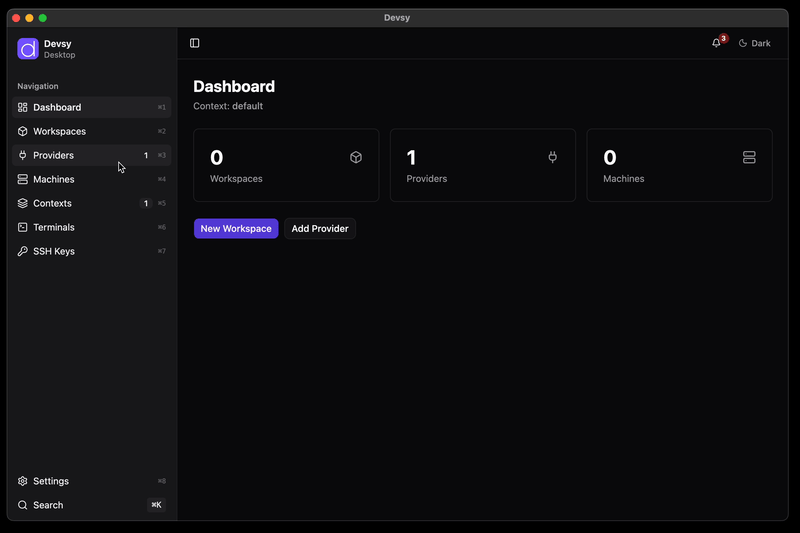

 

  <a href="https://www.devsy.sh">
    <picture width="500">
      <source media="(prefers-color-scheme: dark)" srcset="sites/docs-devsy-sh/public/docs/media/devsy-dark.png">
      
    </picture>
  </a>

Devsy gives teams and their AI coding agents separate workspaces built from one standard definition. Workspaces run on Docker, Kubernetes, cloud providers, and SSH remote hosts.

Local external providers keep their configured runtime options when you use `devsy workspace up --disable-daemon`. Provider options stay out of the workspace agent payload in this mode.

<table align="center">
<tr>
<td><b>Website</b></td>
<td><a href="https://www.devsy.sh">https://www.devsy.sh</a></td>
</tr>
<tr>
<td><b>Quickstart</b></td>
<td><a href="https://www.devsy.sh/docs/getting-started/install">https://www.devsy.sh/docs/getting-started/install</a></td>
</tr>
<tr>
<td><b>Documentation</b></td>
<td><a href="https://www.devsy.sh/docs/what-is-devsy">https://www.devsy.sh/docs/what-is-devsy</a></td>
</tr>
<tr>
<td><b>Repository</b></td>
<td><a href="https://github.com/devsy-org/devsy">https://github.com/devsy-org/devsy</a></td>
</tr>
</table>

<h2 align="center">Downloads</h2>

Devsy has a desktop app and a command-line tool.
See the <a href="https://devsy.sh/docs/getting-started/install">Devsy Docs</a> for install steps.

<table align="center" width="80%">
<tr>
<td width="50%" valign="top">

<h3>Desktop application</h3>

<table>
<tr>
<th>Platform</th>
<th>Architecture</th>
<th>Download</th>
</tr>
<tr>
<td><b>macOS</b></td>
<td>Apple Silicon (ARM64)</td>
<td></td>
</tr>
<tr>
<td><b>macOS</b></td>
<td>Intel (x64)</td>
<td></td>
</tr>
<tr>
<td><b>Windows</b></td>
<td>x64 (Installer)</td>
<td></td>
</tr>
<tr>
<td><b>Linux</b></td>
<td>x64 (AppImage)</td>
<td></td>
</tr>
<tr>
<td><b>Linux</b></td>
<td>x64 (Debian/Ubuntu)</td>
<td></td>
</tr>
<tr>
<td><b>Linux</b></td>
<td>x64 (RPM)</td>
<td></td>
</tr>
<tr>
<td><b>Linux</b></td>
<td>x64 (Flatpak)</td>
<td></td>
</tr>
</table>

</td>
<td width="50%" valign="top">

<h3>CLI</h3>

<table>
<tr>
<th>Platform</th>
<th>Architecture</th>
<th>Download</th>
</tr>
<tr>
<td><b>macOS</b></td>
<td>Apple Silicon (ARM64)</td>
<td></td>
</tr>
<tr>
<td><b>macOS</b></td>
<td>Intel (x64)</td>
<td></td>
</tr>
<tr>
<td><b>Linux</b></td>
<td>x64</td>
<td></td>
</tr>
<tr>
<td><b>Linux</b></td>
<td>ARM64</td>
<td></td>
</tr>
<tr>
<td><b>Windows</b></td>
<td>x64</td>
<td></td>
</tr>
<tr>
<td><b>Windows</b></td>
<td>ARM64</td>
<td></td>
</tr>
</table>

</td>
</tr>
</table>

<h2 align="center">Features</h2>

Devsy uses the open <a href="https://containers.dev/">DevContainer standard</a>. Workspaces are portable across provider backends.

<table>
<tr>
<td width="50%" valign="top">
<b>Cost savings</b> 
Run workspaces locally or remotely. Auto-shutdown stops idle ones.
</td>
<td width="50%" valign="top">
<b>No vendor lock-in</b> 
Use cloud providers or self-managed platforms.
</td>
</tr>
<tr>
<td width="50%" valign="top">
<b>Flexible development</b> 
Run the same environment locally and remotely.
</td>
<td width="50%" valign="top">
<b>Cross-IDE support</b> 
Works with VS Code and JetBrains.
</td>
</tr>
<tr>
<td width="50%" valign="top">
<b>Feature set</b> 
Prebuilds, inactivity shutdown, and Git and Docker credential sync.
</td>
<td width="50%" valign="top">
<b>Desktop App</b> 
The desktop app manages workspaces. The CLI runs automation and platform integration.
</td>
</tr>
</table>

<h2 align="center">Containers for agents</h2>

Devsy runs each AI coding agent in its own container, built from the same <code>devcontainer.json</code> your team uses. What a container can reach depends on the provider, mounts, network, and configuration.

<table>
<tr>
<td width="50%" valign="top">
<b>Separate containers</b> 
Each agent workspace runs in its own container, apart from your other workspaces.
</td>
<td width="50%" valign="top">
<b>Credential sync</b> 
Git and Docker credentials sync into the workspace, and code in the container can use them. Review <code>devcontainer.json</code> before you start a workspace. See <a href="https://devsy.sh/docs/developing-in-workspaces/credentials">Reuse local credentials</a>.
</td>
</tr>
<tr>
<td width="50%" valign="top">
<b>Destroy and rebuild</b> 
Delete a container and rebuild it from <code>devcontainer.json</code>.
</td>
<td width="50%" valign="top">
<b>One environment, many agents</b> 
Start as many agent workspaces as you need from the definition your team uses for development.
</td>
</tr>
<tr>
<td width="50%" valign="top">
<b>Choose where agents run</b> 
Use local Docker for small tasks. Use Kubernetes or cloud providers for many agents at once. Auto-shutdown stops idle agent workspaces.
</td>
<td width="50%" valign="top">
<b>Same setup every time</b> 
Every workspace starts from the same definition.
</td>
</tr>
</table>
